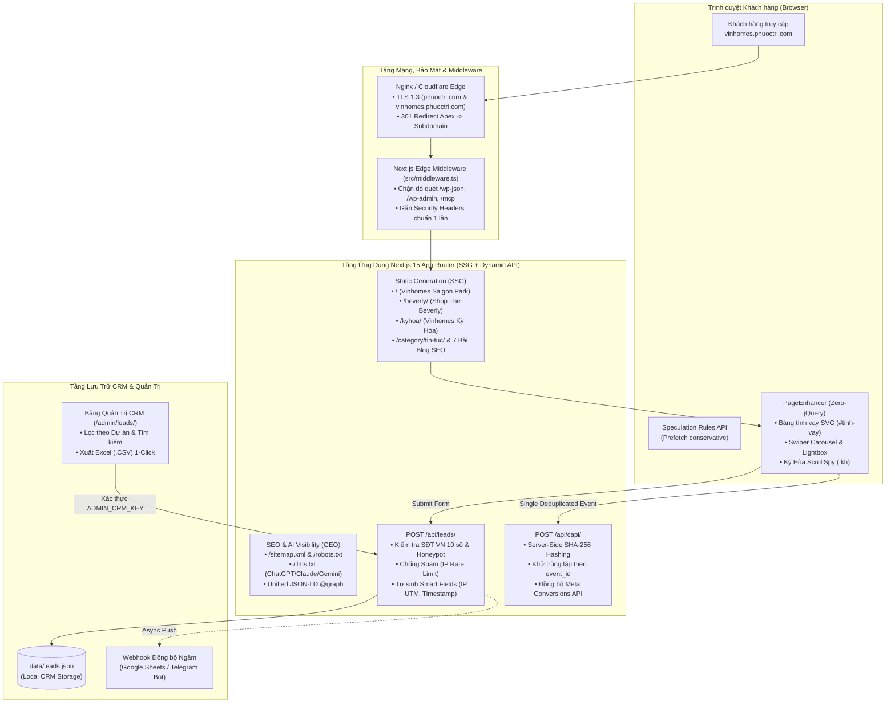

# Kiến Trúc Kỹ Thuật Next.js 15, Hệ Thống CRM Nội Bộ, Server-Side CAPI & Chiến Lược SEO/GEO (`vinhomes.phuoctri.com`)

---

## 1. Sơ Đồ Kiến Trúc Tổng Thể (`vinhomes.phuoctri.com`)

---

## 2. Cơ Chế Hoạt Động Của 4 Thành Phần Cốt Lõi

### 2.1. Bộ Điều Khiển Tương Tác `PageEnhancer.tsx` (Thay Thế 100+ Script Cũ)
Thay vì bắt trình duyệt tải hàng chục tệp JavaScript của WordPress, Elementor, Swiper, jQuery và Tablesome, toàn bộ tương tác trên trang được xử lý bởi một React Client Component duy nhất (`src/components/PageEnhancer.tsx`):
1. **Mô phỏng Tài chính & Biểu đồ SVG Động (`#tinh-vay`)**:
   - Tự động nhận diện bảng màu theo trang (Xanh Ngọc Lục Bảo `#0E403C` trên Trang chủ & Blog; Xanh Navy Hoàng Gia `#0B1F4A` trên trang `/beverly/`).
   - Hỗ trợ 2 phương thức trả nợ: **Dư nợ giảm dần (`dec`)** và **Trả đều hàng tháng / Niên kim cố định (`ann`)**.
   - Vẽ biểu đồ cột chồng `<svg id="tlc-svg">` thời gian thực, bổ sung cột viền nét đứt minh họa những năm được **Hỗ trợ lãi suất 0% + Ân hạn nợ gốc**.
2. **Trình chiếu Băng chuyền Hình ảnh (`Swiper Engine`)**:
   - Điều khiển mượt mà các bộ ảnh Pháp lý, Địa thế quy hoạch và Tiện ích trên Trang chủ với hiệu ứng trượt ngang `cubic-bezier(0.25, 1, 0.5, 1)`, chấm phân trang tương tác, tự động chuyển ảnh mỗi `5.000ms`, tạm dừng khi di chuột vào và hỗ trợ vuốt cảm ứng trên di động.
3. **Hộp Phóng to Bản đồ Độ phân giải Cao (`Enterprise Lightbox`)**:
   - Cho phép xem cận cảnh các bản đồ quy hoạch 1/500, bảng giá sơ bộ Shop The Beverly, phóng to `2x`, chuyển ảnh Trước/Sau bằng bàn phím (`ArrowLeft` / `ArrowRight` / `Escape`) và tải trực tiếp tệp ảnh gốc về máy.

### 2.2. Hệ Thống Thu Thập Khách Hàng `/api/leads/` & Bảng Quản Trị `/admin/leads/`
- **Xác thực & Chống Spam Đa Lớp**:
  - Kiểm tra trường ẩn Honeypot (`website_url`) để loại bỏ 100% bot tự động mà không làm phiền khách hàng bằng hộp kiểm reCAPTCHA v2.
  - Kiểm tra định dạng số điện thoại di động Việt Nam 10 số (`03x`, `05x`, `07x`, `08x`, `09x`, `+84...`).
  - Giới hạn tốc độ gửi theo địa chỉ IP (`Rate Limiter`).
- **Tự Động Đính Kèm Trường Thông Minh (`Server-Side Smart Fields`)**:
  - Ghi nhận chính xác: Mã hồ sơ (`PT-261014-xxx`), Giờ Việt Nam (`Asia/Ho_Chi_Minh`), Dự án quan tâm (`Vinhomes Saigon Park`, `Shop Beverly`, `Vinhomes Kỳ Hòa`), URL nguồn kèm tham số quảng cáo (`utm_source`, `utm_medium`, `utm_campaign`, `fbclid`, `gclid`) và Địa chỉ IP.

### 2.3. Chuẩn Hóa SEO & Hiển Thị Trên Trí Tuệ Nhân Tạo (GEO – `/llms.txt`)
- **Đồ thị Tri thức Schema.org (`src/lib/seo-schema.ts`)**: Mỗi trang chỉ xuất **1 khối JSON-LD `@graph` duy nhất**, kết nối chặt chẽ giữa thực thể cá nhân **Nguyễn Phước Trí (`#person`)**, đại lý **Phước Trí Vinhomes (`#agent`)**, dự án bất động sản (`Place`), câu hỏi thường gặp (`FAQPage`) và bài viết phân tích (`BlogPosting`).
- **Tệp chỉ mục AI `/llms.txt`**: Cung cấp bản tóm tắt cấu trúc chuẩn Markdown cho các công cụ tìm kiếm AI (ChatGPT Search, Perplexity, Claude, Google Gemini), giúp thương hiệu **Phước Trí Vinhomes (`0909.888.999`)** được ưu tiên trích dẫn khi nhà đầu tư tra cứu thông tin dự án.
